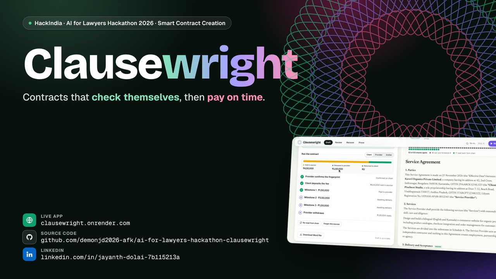
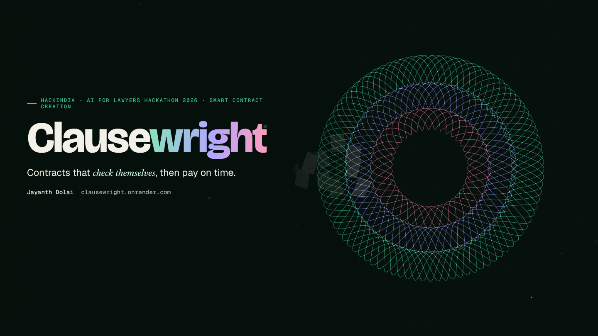
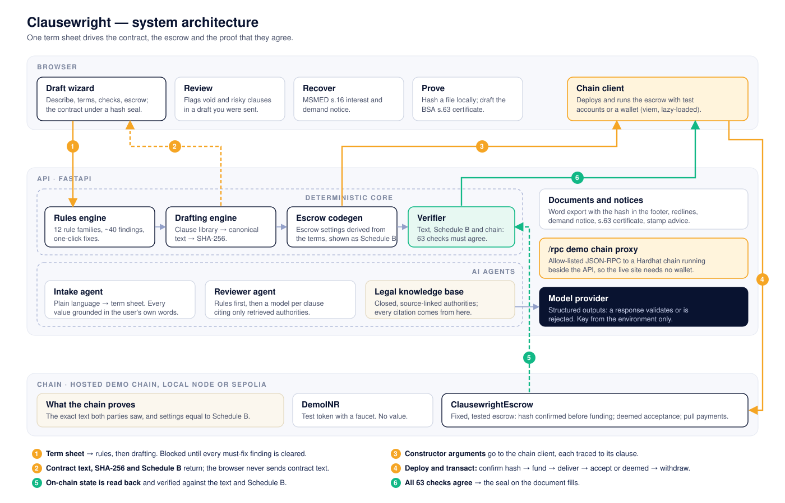

# Clausewright

Contracts for Indian small businesses that check themselves against the law, and an escrow that is provably bound to the contract it enforces.

Built for the HackIndia **AI for Lawyers Hackathon 2026**, problem statement **PS-03 · Smart Contract Creation**.

[](https://youtu.be/xrd0M-bRYHM)

| | |
|---|---|
| **Live app** | [clausewright.onrender.com](https://clausewright.onrender.com/) — no sign-up and no wallet needed |
| **Demo video** | [Watch on YouTube](https://youtu.be/xrd0M-bRYHM) — 3 minutes, filmed on the live app |
| **Pitch deck** | [Open the 3D presentation](https://demonjd2026-afk.github.io/ai-for-lawyers-hackathon-clausewright/pitch/) — eight slides |
| **Source code** | This repository |

## Contents

- [Try it](#try-it)
- [The problem](#the-problem)
- [What Clausewright does](#what-clausewright-does)
- [Demo video and pitch deck](#demo-video-and-pitch-deck)
- [Architecture](#architecture)
- [Results](#results)
- [Run it](#run-it)
- [Repository](#repository)
- [Documents](#documents)
- [Limits](#limits)

## Try it

Open the [live app](https://clausewright.onrender.com/) and press **Watch the demo**. The app drives its own interface through all four tools in about three minutes, and you can stop it at any point:

1. **Draft and escrow:** load a deal, fix six legal defects, draft the contract, deploy the escrow, verify 63 of 63 checks, then fund, deliver and accept a milestone.
2. **Review:** a sample contract with common traps, read clause by clause.
3. **Recover:** two unpaid invoices become an interest claim and a demand notice.
4. **Prove:** a contract is matched to its recorded fingerprint and the court certificate is drafted.

Review, Recover and Prove each also have a **Watch this page's demo** button that plays only that part.

To do it by hand: *Draft → Website build for a client → Apply fixes → Set up escrow → Deploy escrow*.

The free host sleeps when idle, so the first load can take up to a minute.

## The problem

- Micro and small enterprises are owed **₹20,979 crore** in delayed payments still pending before MSME Samadhaan (14 Aug 2026), although the MSMED Act caps payment at 45 days and adds compound interest at three times the RBI Bank Rate.
- Most freelancer and SME contracts are drafted from templates that put in **void clauses** (post-term non-competes), **invalid clauses** (one party appoints the arbitrator) and **unenforceable ones** (penalties, 90-day payment terms against a micro supplier), and leave out the ones that matter (acceptance mechanics, DPDP processor terms, a valid copyright assignment).
- AI drafting tools make this worse when they invent authorities. On 2 July 2026 the Supreme Court called citing unverified AI judgments **misconduct**.
- "Smart contracts" usually mean code that nobody can tie back to the legal text, so when the two disagree there is no way to tell which one is right.

## What Clausewright does

| | |
|---|---|
| **Draft** | Service agreements with milestones, mutual NDAs and appointment letters under the Labour Codes, generated by fixed rules from one term sheet. The same terms always give the same text and the same SHA-256. |
| **Check** | 12 rule families covering the MSMED Act, Contract Act ss.11/27/28/74, CORE (2024) on arbitrator appointment, the Copyright Act s.19 defaults, DPDP processor duties, stamp duty, e-signing, GST/TDS, wage-code rules and the escrow. Every finding cites an authority from a closed, source-linked list; most carry a one-click fix. Nothing is drafted while a must-fix item is open. |
| **Bind** | Generates the settings for an audited Solidity escrow from the *same* term sheet, puts them in the contract as Schedule B, and records the contract's SHA-256 on-chain. The provider confirms that hash on-chain before the client can fund. |
| **Verify** | Re-parses the contract (figures *and* words), re-derives the escrow settings and reads the deployed contract back from chain. Every value must agree three ways (63 checks for the sample deal). The seal on the document fills only when they do. |
| **Enforce** | The escrow pays a milestone when the client accepts it, or when the client stays silent past the window (MSMED s.2(b) deemed acceptance). Disputes go to a neutral arbiter or a mutual settlement. |
| **Review** | Flags risky clauses in a contract you were sent. Rules run first; an optional AI pass sees each clause with authorities retrieved for it and can cite only those. |
| **Recover** | Computes s.16 interest (monthly rests, rate history) and drafts an MSME demand notice. |
| **Prove** | Hashes a file in the browser and drafts Part A of the BSA s.63(4) certificate, which requires the hash. |

## Demo video and pitch deck

**Demo video (2:56).** [Watch on YouTube](https://youtu.be/xrd0M-bRYHM). It is a recording of the live app, in this order: the problem, drafting and legal checks, the contract's fingerprint, deploying and verifying the escrow, the milestone payment, then Review, Recover and Prove.

**Pitch deck (8 slides).** [Open the presentation](https://demonjd2026-afk.github.io/ai-for-lawyers-hackathon-clausewright/pitch/). Use the arrow keys, Space or a swipe to move between slides, and F for full screen.

[](https://demonjd2026-afk.github.io/ai-for-lawyers-hackathon-clausewright/pitch/)

| Slide | What it covers |
|---|---|
| 1 | Title |
| 2 | The problem: unenforceable clauses, unlawful payment terms, invented authorities |
| 3 | The idea: one term sheet, a contract and an escrow, proven identical |
| 4 | How it works: describe, check, draft, bind, verify |
| 5 | What is new: the three-way check, the fenced-in AI reviewer, the hash-driven seal |
| 6 | Proof: the test and evaluation results below |
| 7 | Beyond drafting: Review, Recover, Prove |
| 8 | Impact and links |

The deck is a single page at [docs/pitch/index.html](docs/pitch/index.html), served by GitHub Pages.

## Architecture



One term sheet drives everything. Fixed rules write the contract and hash it; the escrow's settings are derived from the same terms and printed in the contract as Schedule B; after deployment the on-chain state is read back and verified against the text, and the seal on the document fills only when all 63 checks agree. Details: [docs/ARCHITECTURE.md](docs/ARCHITECTURE.md).

## Results

| Evaluation | Result |
|---|---|
| Backend tests (unit, property-based, API, agents with fake LLM) | **133 passed** |
| Solidity tests (unit, 512-run fuzz, 3 invariants: solvency, conservation, only-parties-paid) | **35 passed** |
| Verifier mutation testing: 30 seeded inconsistencies across prose, schedules and chain | **30/30 detected** |
| Compliance gate: 6 seeded legal defects | **6/6 blocked** before drafting |
| Reviewer rule layer: 46 labelled clauses, near-miss negatives included | **100% precision, 96% recall** |
| On-chain end to end: API → deploy → verify → fund → deemed acceptance → withdraw; tampered deploy | **9/9** |
| AI intake golden set: 4 conversations, 21 graded fields, one prompt-injection attempt (live model) | **100% field accuracy**, injection ignored |
| AI reviewer on the sample contract (live model): citations outside the verified list | **1 produced, 1 dropped** ([sample](samples/review-report-ai.md)) |
| `pip-audit`, `npm audit` (3 packages), `bandit`, `slither` | **0 findings** (Slither timestamp notes are by design; see [docs/SECURITY.md](docs/SECURITY.md)) |

The reviewer corpus was written and labelled by the authors, so the 46-clause figure is not an independent benchmark. The one recall miss comes from a sentence written after the patterns were fixed; it is kept in the corpus rather than tuned away. Full report: [evals/RESULTS.md](evals/RESULTS.md).

## Run it

Requirements: Python 3.13, Node 22.

```bash
# 1. API
cd backend
python -m venv .venv && .venv/bin/pip install -r requirements-dev.txt
cp .env.example .env                  # add CLAUSEWRIGHT_MODEL_API_KEY to enable AI intake and AI review
.venv/bin/uvicorn app.main:app --port 8000

# 2. Local chain (separate terminal)
cd contracts && npm ci && npm run node

# 3. Web app (separate terminal)
cd frontend && npm ci && npm run dev   # http://localhost:5173
```

In the app, choose **Website build for a client**, apply the fixes, then **Set up escrow → Deploy escrow**. The local chain uses its built-in test accounts, so no wallet extension is needed.

Production: `docker build -t clausewright .` serves the API and the built app on one port and runs a demo chain beside them, so the hosted app can show the whole escrow flow without a wallet (see [docs/ARCHITECTURE.md](docs/ARCHITECTURE.md)). `render.yaml` deploys it to Render; set `CLAUSEWRIGHT_MODEL_API_KEY` there to turn on AI intake and review. For Sepolia, deploy the demo token once with `contracts/scripts/deploy-token.mjs` and set `CW_DEMO_TOKEN_ADDRESS`.

```bash
cd backend && .venv/bin/pytest -q                     # tests
.venv/bin/python ../evals/run_evals.py                # evals -> evals/RESULTS.md
../evals/run_onchain_e2e.sh                           # on-chain end to end
.venv/bin/python scripts/make_samples.py              # regenerate samples/
cd ../contracts && npx hardhat test solidity          # Solidity tests
```

## Repository

```
backend/    FastAPI service: models, rules, drafting, verifier, agents, exports
contracts/  ClausewrightEscrow.sol, DemoINR.sol, Solidity tests, deploy and e2e scripts
frontend/   React app: draft, review, recover, prove
evals/      eval runner, labelled corpora, on-chain e2e, RESULTS.md
samples/    sample legal outputs (contracts, Word files, notice, certificate, review, redline)
docs/       architecture, AI workflow, escrow design, security, legal basis, pitch deck (docs/pitch)
```

## Documents

- [Demo video](https://youtu.be/xrd0M-bRYHM)
- [Pitch deck](https://demonjd2026-afk.github.io/ai-for-lawyers-hackathon-clausewright/pitch/)
- [Architecture](docs/ARCHITECTURE.md)
- [AI workflows and models](docs/AI_WORKFLOW.md)
- [Escrow design](docs/ESCROW.md)
- [Security](docs/SECURITY.md)
- [Legal basis and research](docs/LEGAL_BASIS.md)
- [Sample outputs](samples/README.md)

## Limits

Clausewright is not a law firm and its output is not legal advice. It covers three document types and the authorities listed in `backend/app/legal/kb.py`, each tagged verified or secondary with its source. Stamp-duty figures are shown only for states whose rates were confirmed against the state amendment (Maharashtra and Tamil Nadu so far). Escrows run on test networks with a demo token that has no value. A production version should settle in rupees through a regulated escrow or RBI's programmable e-rupee, and use the chain only to anchor state and hashes.

## Licence

MIT
