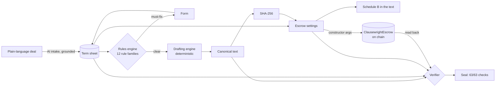

# Architecture

## Principle: one source of truth, three derived artifacts, one proof

The **term sheet** (`backend/app/models.py`) is the only input. The contract text, the escrow settings and Schedule B are pure functions of it. The verifier does not trust the generator: it re-parses the output and checks everything against an independent derivation.

## Components

| Path | Responsibility |
|---|---|
| `app/models.py` | Strict Pydantic term sheet: no extra fields, money in integer paise, Udyam/GSTIN/address validation, per-type structural rules |
| `app/compliance/rules.py` | Deterministic checks; each yields a `Finding` with severity, cited authorities and an optional `autofix {path, value}` |
| `app/legal/kb.py` | Closed list of authorities with source URL and verification status. Every citation anywhere must be one of these ids |
| `app/legal/rates.py` | Time-varying values: Bank Rate history, s.16 interest calculator, MSME thresholds, verified stamp rates |
| `app/drafting/engine.py` | Clause library and assembly; `canonical()` normalises text before hashing |
| `app/drafting/text.py` | Sanitises user text (NFC, strips control and bidi characters, neutralises headings and table pipes) so input cannot forge contract structure |
| `app/codegen/escrow.py` | Term sheet → constructor arguments; clause ↔ setting map |
| `app/verify/consistency.py` | Three-way verifier: term sheet ↔ prose (figures and Indian-English words) ↔ Schedule B ↔ deployed contract |
| `app/agents/intake.py` | AI extraction with evidence grounding and clarifying questions |
| `app/agents/reviewer.py` | Rule patterns plus a citation-restricted AI review |
| `app/legal/retrieval.py` | BM25 over the knowledge base, with lay-to-legal synonym expansion |
| `app/export/` | Word export (hash in footer, AI-assistance notice in header) and clause-aware redline |
| `app/drafting/notices.py` | MSME demand notice; BSA s.63 certificate, Part A |
| `contracts/ClausewrightEscrow.sol` | Milestone escrow (see [ESCROW.md](ESCROW.md)) |
| `frontend/` | React 19 + Vite 8; viem for chain access, loaded only on the escrow step |

## Request flow (drafting)

1. The browser edits the term sheet and debounces `POST /api/check` (rules only).
2. With no must-fix findings it calls `POST /api/draft`. The server evaluates the rules again, assembles the text, hashes it, derives the escrow settings, runs the verifier and returns everything.
3. The browser deploys the escrow with the returned constructor arguments, reads the contract back, and calls `POST /api/verify` with what it read.

Clients never send contract text. The server rejects unknown fields, so a client cannot get a fingerprint for text the engine did not write.

## Determinism

- Clause text depends only on the term sheet. "Today" affects only findings, never text.
- Contract text never embeds a changing rate. It says "three times the bank rate", and the calculators apply the rate history.
- Canonical form before hashing: NFC, LF line endings, no trailing spaces, one trailing newline.
- Due dates become 23:59:59 IST of the stated day, so the chain and the text name the same deadline.

## Money

Integer paise end to end: term sheet, escrow (DemoINR has 2 decimals, so 1 unit = 1 paisa), verifier. Amount expressions from intake ("1.5 lakh") are parsed with exact integer arithmetic. Interest uses `Fraction` and is rounded once, at the end.

## Deployment

One container: FastAPI serves `/api/*` and the built React app. In-process rate limiting assumes one instance; put a shared store behind `RateLimiter` before scaling out.
