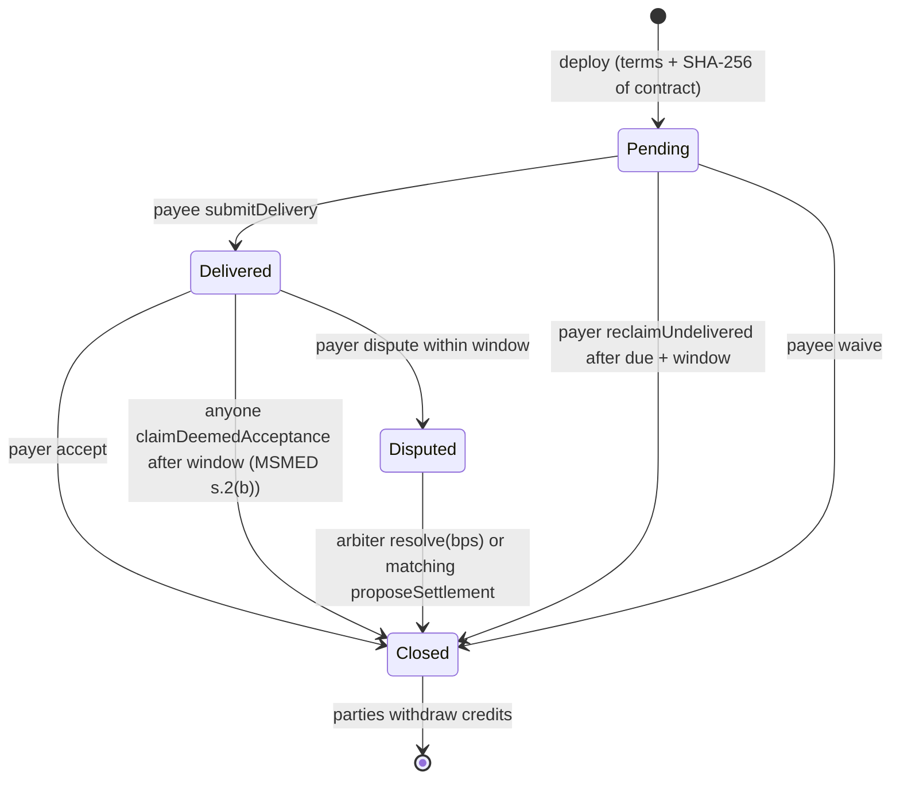

# Escrow design (`contracts/contracts/ClausewrightEscrow.sol`)

## Why a fixed contract and not generated Solidity

Generating Solidity with a model for each deal would put unaudited code in charge of money. Clausewright ships **one** escrow contract, tested with unit, fuzz and invariant tests, and generates only its **constructor arguments** from the term sheet. Every argument is printed in Schedule B and traced to the clause that governs it.

## Lifecycle

Before any milestone can move:
1. The payee calls `acknowledge(hash)` with the SHA-256 of the contract it read. A different hash reverts.
2. The payer calls `fund(hash)`, which transfers the full fee. This must happen by the funding deadline, and the contract checks the balance actually received, so fee-on-transfer tokens are rejected.

## Law → code

| Contract clause | Code |
|---|---|
| Delivery and Acceptance: object within N days or deemed accepted | `acceptanceWindow`; `dispute` only inside it; `claimDeemedAcceptance` only after it |
| MSMED s.2(b): 15-day statutory window for MSE suppliers | `msmeMode` caps `acceptanceWindow` at 15 days in the constructor |
| MSMED s.15: payment within 45 days | Funds are deposited before work starts, so acceptance releases payment at once |
| Dispute Resolution: no unilateral appointment (CORE, 2024) | Arbiter must differ from both parties; replacing it needs both parties to name the same neutral address |
| Termination | `proposeCancel` by both parties refunds open milestones |
| "This Agreement prevails over the escrow" | Schedule B text; the escrow is a payment mechanism, not the contract |

## Safety properties

- **Pull payments:** settlements credit balances, and parties call `withdraw`. No push transfers inside state changes.
- **ReentrancyGuard** on `fund` and `withdraw`; checks-effects-interactions throughout. The tests include a re-entering token.
- **No owner, admin, upgrade or pause.** Only the parties and the arbiter can affect funds, each only through their own functions.
- **SafeERC20** for transfers; the token must be a contract.
- **Bounded loops:** at most 20 milestones.
- **Rounding:** splits use floor for the payee, and the dust goes to the payer.
- **Custom errors** for every revert; the UI maps each to plain language.

## Invariants (fuzzed, 512 runs × random action sequences)

- `token.balanceOf(escrow) == totalCredits + openAmount`: always exactly solvent.
- `openAmount + totalCredits + withdrawn == total funded`: no value created or destroyed.
- The arbiter never receives funds.

## Timestamps

Windows are measured in days, and validators can shift timestamps by seconds, so `block.timestamp` is appropriate here. Slither's timestamp notes are acknowledged for this reason.

## Network and token

Demos run on a Hardhat chain (the hosted app runs one beside the API, reached through `/rpc`; locally, `npm run node` in `contracts/`) or on Sepolia, with **DemoINR**, a 2-decimal test token with a rate-limited faucet. It has no value and is not a representation of the rupee or of RBI's e-rupee. A production deployment should settle in INR through a regulated escrow, or through programmable e-rupee if and when RBI opens that to such uses, and keep on-chain state and hash anchoring.
